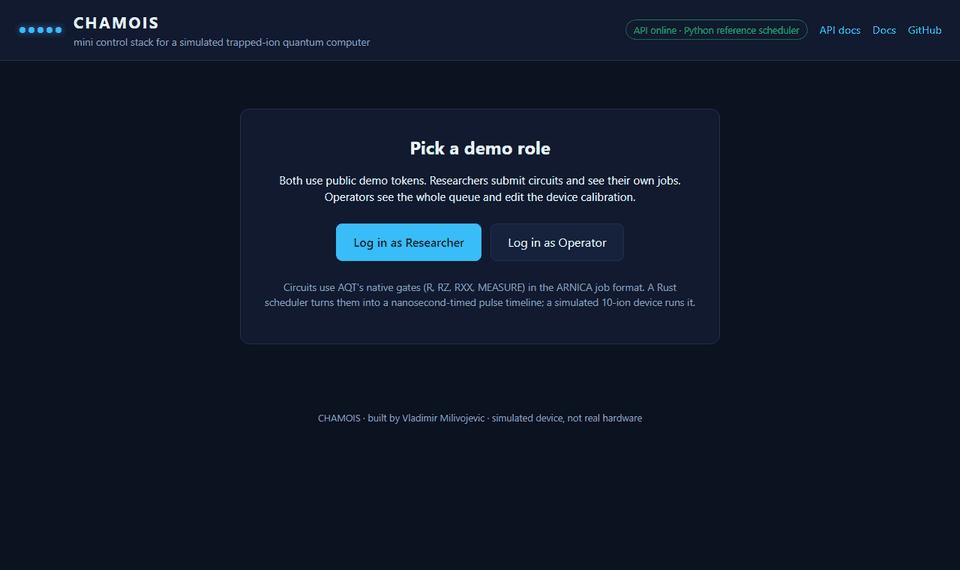
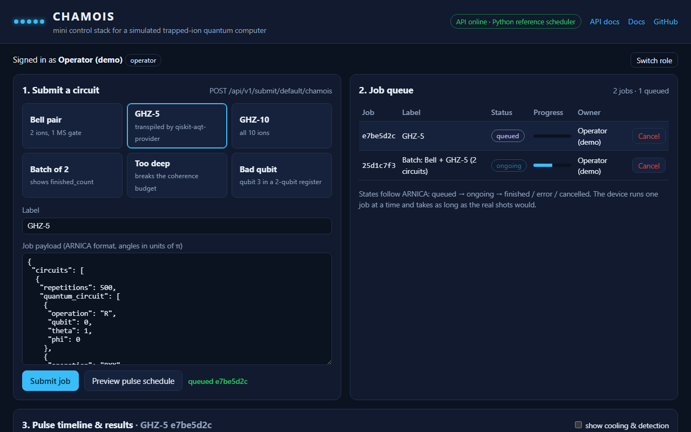
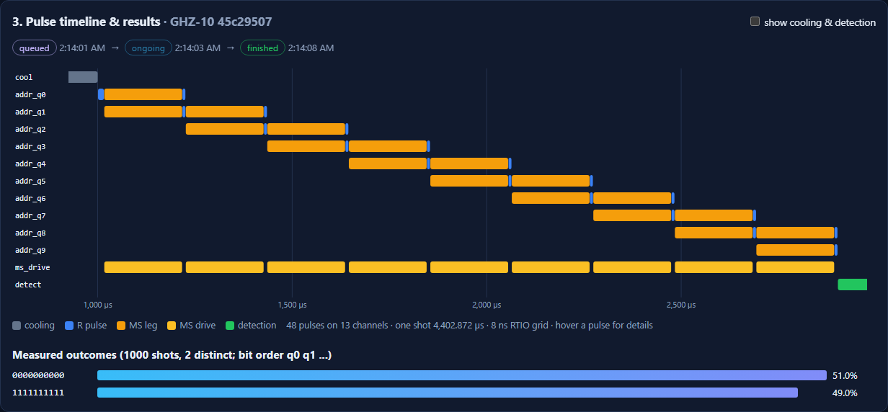
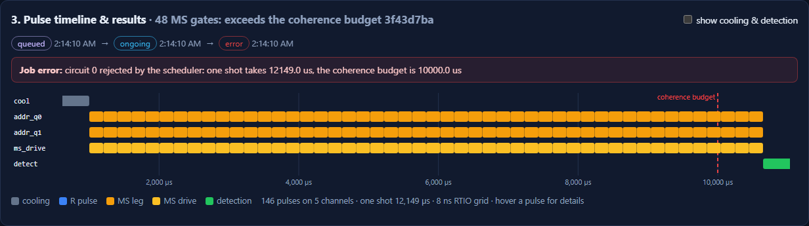
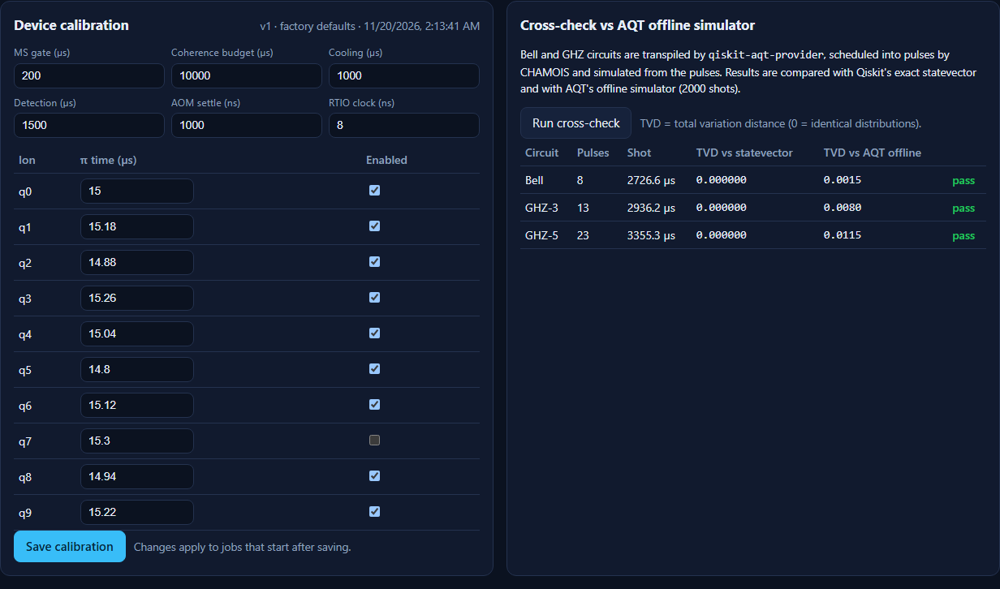
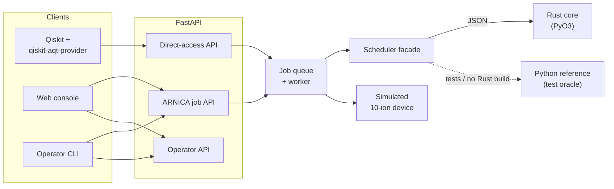
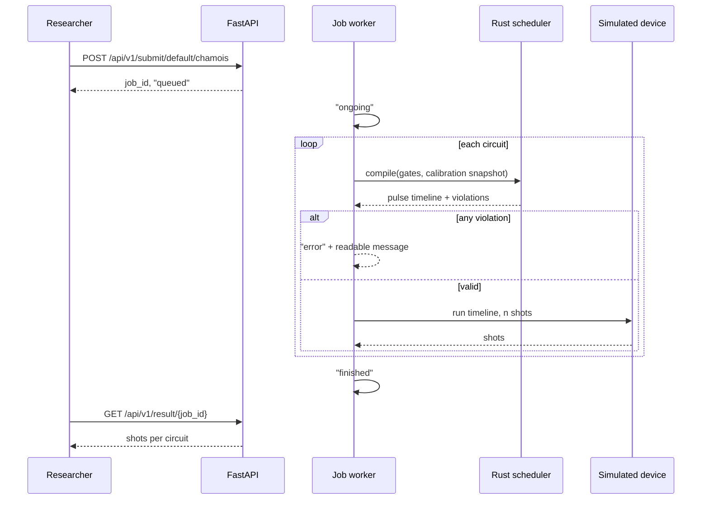
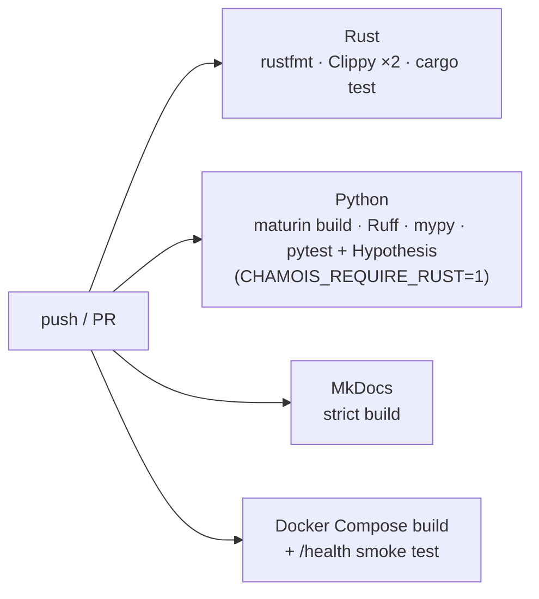

<div align="center">


# CHAMOIS

**A mini control stack for a simulated trapped-ion quantum computer:**
circuits in AQT's native gates go in through an ARNICA-style job API, a Rust scheduler turns them into a
nanosecond-timed pulse timeline per laser channel, and a simulated 10-ion device runs the pulses.

[](https://github.com/vladimirmilivojevic-creator/chamois/actions/workflows/ci.yml)


[](LICENSE)

### [▶ Open the live demo](https://chamois-api.onrender.com) &nbsp;·&nbsp; [API docs](https://chamois-api.onrender.com/docs) &nbsp;·&nbsp; [Documentation](https://vladimirmilivojevic-creator.github.io/chamois/) &nbsp;·&nbsp; [How it works](#how-it-works)



</div>

---

## Try it in 30 seconds

Open the [live demo](https://chamois-api.onrender.com), pick a role, choose a preset and press **Submit job**.

| Role | Token (public demo) | What you can do |
| --- | --- | --- |
| **Researcher** | `researcher-demo-token` | submit circuits, see your own jobs, pulse timelines and results, preview a schedule, run the cross-check |
| **Operator** | `operator-demo-token` | everything above, plus the whole queue, cancelling any job and editing the device calibration |

Good first clicks: **GHZ-10** (all 10 ions, watch `queued → ongoing → finished`), **Too deep** (the scheduler
rejects a circuit that breaks the coherence budget), and **Run cross-check**.

> [!NOTE]
> The demo runs on a free Render instance that sleeps when nobody uses it. The first request can take up to a
> minute; after that it is fast. The device is simulated, not real hardware.

## Highlights

<table>
<tr>
<td width="33%"><b>ARNICA-compatible API</b><br>Same routes, field names, angle units (π), limits and job states as AQT's public ARNICA API: <code>queued → ongoing → finished / error / cancelled</code>.</td>
<td width="33%"><b>Rust pulse scheduler</b><br>Compiles R, RZ, RXX into timed pulses per laser channel from per-ion calibration, on an 8 ns RTIO clock grid, following ARTIQ's RTIO model. PyO3 bindings, built with maturin.</td>
<td width="33%"><b>Rejects bad timelines</b><br>Overlaps, too-short gaps, off-grid timestamps, disabled ions and shots longer than the coherence budget are stopped <i>before</i> the device runs.</td>
</tr>
<tr>
<td><b>Device that sees only pulses</b><br>Rotation angles come from pulse duration ÷ calibrated π time, phases from virtual-Z frames. A scheduler bug would change the measured result.</td>
<td><b>Cross-checked with AQT's tools</b><br>Bell and GHZ results match Qiskit's statevector and the offline simulator of <code>qiskit-aqt-provider</code>; AQT's own provider runs circuits on CHAMOIS unchanged.</td>
<td><b>Property-tested</b><br>Hypothesis compares the Rust core with a Python reference model and the simulator with Qiskit on random circuits. It found two real bugs (see below).</td>
</tr>
</table>

## Screenshots

| Operator console | Pulse timeline + results (GHZ-10) |
| --- | --- |
|  |  |
| **Rejected: coherence budget** | **Calibration + cross-check** |
|  |  |

## How it works





### From gates to pulses

| Gate | Becomes | Duration |
| --- | --- | --- |
| `R(θ, φ)` on ion *q* | one pulse on `addr_q` with phase φ − frame(*q*) | θ × π-time(*q*) |
| `RZ(φ)` | **no pulse**: φ is added to the ion's phase frame (virtual Z) | 0 |
| `RXX(θ)` on *a*, *b* | pulses on `addr_qa`, `addr_qb` and the shared `ms_drive` at the same time | (θ / 0.5) × MS gate time |
| `MEASURE` | detection on all ions after every channel is free | 1.5 ms |

Every channel has its own cursor, like the `now` cursor in ARTIQ: gates on different ions run in parallel, gates
on one ion queue up, and MS gates never overlap because they share `ms_drive`. The operator CLI prints the
result (`chamois timeline <job>`):

```text
gate window 1001.0 - 1225.6 us (one shot: 2726.6 us)
     cool |c                                                                       |
  addr_q0 |#####===============================================================### |
  addr_q1 |     ===============================================================####|
 ms_drive |     ~~~~~~~~~~~~~~~~~~~~~~~~~~~~~~~~~~~~~~~~~~~~~~~~~~~~~~~~~~~~~~~~   |
   detect |                                                                       d|
legend: # R pulse   = MS leg   ~ MS drive   c cooling   d detection
```

More detail: [timing model](https://vladimirmilivojevic-creator.github.io/chamois/timing-model/).

### Standard Qiskit circuits, through AQT's own provider

CHAMOIS also implements the small direct-access API that `qiskit-aqt-provider` uses for on-premise devices, so
AQT's official client code runs circuits on it unchanged:

```python
from qiskit import QuantumCircuit, transpile
from chamois.qiskit_bridge import chamois_backend  # AQTProvider().direct_access().get_resource(...)

backend = chamois_backend("https://chamois-api.onrender.com", "researcher-demo-token")
bell = QuantumCircuit(2)
bell.h(0)
bell.cx(0, 1)
bell.measure_all()
print(backend.run(transpile(bell, backend), shots=200).result().get_counts())  # e.g. {'00': 97, '11': 103}
```

## Tech stack

| Layer | Technology |
| --- | --- |
| API | Python 3.12, FastAPI, Pydantic v2, pydantic-settings, Uvicorn |
| Scheduler | Rust 2021, serde, PyO3 (optional feature), maturin |
| Simulation | NumPy statevector (up to 10 qubits) |
| Quantum SDK | Qiskit 2, qiskit-aqt-provider (transpiler, offline simulator, direct-access backend) |
| CLI | argparse, httpx, matplotlib (PNG timelines) |
| Console | plain HTML/CSS/JavaScript, SVG timeline, no build step |
| Quality | pytest, Hypothesis, pytest-cov (gate 85 %), cargo test, Ruff, mypy (strict), Clippy, rustfmt, pre-commit |
| Delivery | Docker (multi-stage: Rust wheel → slim runtime), Docker Compose, GitHub Actions, Render, MkDocs Material on GitHub Pages |

## API overview

| Method | Path | Notes |
| --- | --- | --- |
| `GET` | `/api/v1/workspaces` | workspace `default`, resource `chamois` |
| `POST` | `/api/v1/submit/{workspace}/{resource}` | ARNICA job: up to 50 circuits, 2000 shots each |
| `GET` | `/api/v1/result/{job_id}` | state, `finished_count`, shots; `?include_timing_data=true` |
| `DELETE` | `/api/v1/jobs/{job_id}` | queued: dropped; ongoing: stops after the current circuit |
| `GET` | `/api/v1/jobs/{job_id}/schedule` | compiled pulse timeline + violations |
| `POST` | `/api/v1/schedule` | compile a circuit without running it |
| `GET` / `PUT` | `/api/v1/calibration` | read / new version (operator) |
| `GET` | `/api/v1/crosscheck` | Bell/GHZ vs Qiskit and AQT's offline simulator |
| `PUT` / `GET` | `/direct/circuit`, `/direct/circuit/result/{id}` | direct-access API for `qiskit-aqt-provider` |
| `GET` | `/health` | version, scheduler backend (`rust`), queue size |

## Testing and CI



* **Unit and API tests**: job states, roles, calibration versions, cancel semantics, direct access, console presets.
* **Property tests (Hypothesis)**: every compiled timeline obeys the RTIO rules; the Rust core and the Python
  reference produce identical timelines on random circuits; breaking a valid timeline is always detected; the
  pulse-level simulation matches Qiskit's statevector.
* **End to end**: AQT's `qiskit-aqt-provider` submits to a live CHAMOIS server in the test run; Bell, GHZ-4 and
  GHZ-10 match AQT's offline simulator.

**Two bugs the property tests caught** (both in the commit history):

1. `(-1e-178) % 2.0 == 2.0` in IEEE floats, so a pulse phase could leave `[0, 2)`. Python's `%` and Rust's
   `rem_euclid` both do it; both schedulers now clamp.
2. serde_json's default float parser read `-3.9999999999999996` as `-4.0`, so Rust and Python disagreed on a phase
   after crossing the JSON boundary. Fixed with serde_json's `float_roundtrip` feature and a regression test.

<details>
<summary><b>Run locally</b></summary>

```bash
git clone https://github.com/vladimirmilivojevic-creator/chamois && cd chamois
python -m venv .venv && source .venv/bin/activate     # Windows: .venv\Scripts\activate
pip install -e ".[qiskit,plot,dev]"
pip install ./scheduler          # builds the Rust extension (needs a Rust toolchain); optional
chamois serve                    # console on http://127.0.0.1:8000, OpenAPI on /docs
pytest                           # full suite with coverage
cd scheduler && cargo test       # Rust unit tests
```

Without the Rust build the API falls back to the Python reference scheduler and `/health` reports
`"scheduler": "python"`. With Docker: `docker compose up --build` (API on :8000, docs on :8001).

Operator CLI against the live demo:

```bash
export CHAMOIS_URL=https://chamois-api.onrender.com CHAMOIS_TOKEN=operator-demo-token
chamois queue
chamois calibration --disable 7
chamois timeline <job-id> --png timeline.png
```

</details>

## Design decisions

* **JSON across the PyO3 boundary.** One string in, one string out: Pydantic validates on the Python side, serde
  on the Rust side, the boundary is easy to log and replay, and the Rust core has no Python types, so
  `cargo test` and Clippy run without an interpreter (PyO3 is an optional Cargo feature). The GIL is released
  while Rust compiles.
* **A Python reference ("golden") model.** The same rules exist twice on purpose, as in hardware verification:
  Hypothesis checks that both agree. CI and the Docker image set `CHAMOIS_REQUIRE_RUST=1`, so a missing Rust
  build fails loudly instead of silently falling back.
* **Virtual Z.** `RZ` costs no time: it shifts the phase of later pulses, like on trapped-ion hardware. The
  simulator applies the shifted phases, and the tests prove the result equals the gate-level circuit.
* **Validate after compiling.** The compiler cannot produce overlaps by construction, but an independent
  validator checks every timeline anyway, the way ARTIQ refuses events that go back in time on a channel.
* **One worker for one device.** A QPU runs one circuit at a time. A job uses one calibration snapshot from
  start to end and records its version.

## Known limitations

* The device is ideal apart from shot noise: no decoherence, crosstalk or readout errors yet.
* Jobs are kept in memory; a restart clears the queue.
* Demo tokens are public; there is no user management.
* Timing is modelled after ARTIQ's RTIO concepts but there is no FPGA or real-time hardware underneath.

## Roadmap

- [x] ARNICA-compatible job API with job states and timing data
- [x] Rust scheduler with PyO3 bindings and an RTIO-style validator
- [x] Pulse-level statevector simulation, cross-check with `qiskit-aqt-provider`
- [x] Operator CLI, web console, MkDocs docs, CI, Docker
- [ ] Noise model from the calibration (T2, readout error) and fidelity estimates
- [ ] Export the timeline as an ARTIQ experiment (`@kernel` with `delay_mu` / `pulse_mu`)
- [ ] PostgreSQL job store and Redis queue for more than one worker
- [ ] Characterisation endpoint (`/resources/{id}/characterisation`) filled from calibration runs

---

<div align="center">

Built by **Vladimir Milivojevic** · [GitHub](https://github.com/vladimirmilivojevic-creator) · MIT License

<sub>CHAMOIS is an independent learning project. It is not affiliated with AQT; ARNICA and qiskit-aqt-provider are AQT's products, used here through their public documentation and open-source code.</sub>

</div>
