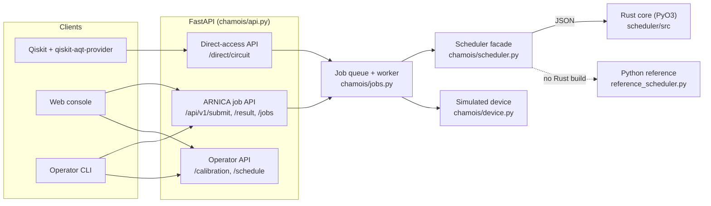
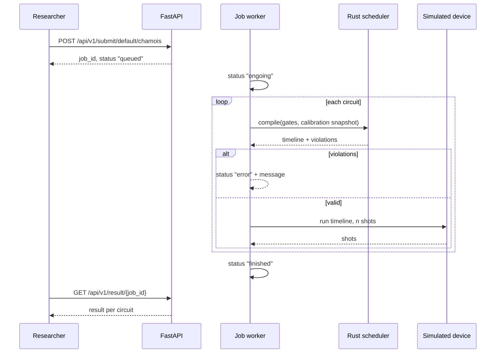

# Architecture

## Request flow

## Files

| File | Responsibility |
| --- | --- |
| `chamois/arnica.py` | Pydantic v2 models that mirror AQT's public ARNICA OpenAPI |
| `chamois/calibration.py` | per-ion calibration and timing constraints |
| `chamois/timeline.py` | pulse, timeline and violation models |
| `scheduler/src/compile.rs` | gates → pulses (Rust) |
| `scheduler/src/validate.rs` | RTIO-style timeline validator (Rust) |
| `scheduler/src/lib.rs` | PyO3 bindings, JSON boundary |
| `chamois/reference_scheduler.py` | same rules in Python, used as test oracle and fallback |
| `chamois/scheduler.py` | picks the Rust core or the reference |
| `chamois/device.py` | statevector simulation of a timeline, calibration versions |
| `chamois/jobs.py` | queue and job state machine |
| `chamois/api.py` | HTTP API and console |
| `chamois/auth.py` | bearer tokens, researcher / operator roles |
| `chamois/qiskit_bridge.py` | Qiskit backend for CHAMOIS, native-gate converter |
| `chamois/crosscheck.py` | Bell/GHZ vs Qiskit statevector and AQT offline simulator |
| `chamois/cli.py` | operator CLI |

## Design decisions

**JSON across the PyO3 boundary.** The Rust function takes one JSON string and returns one. Pydantic
validates on the Python side, serde on the Rust side. The boundary is easy to log and replay, and the Rust
core has no PyO3 types, so `cargo test` and Clippy run without Python. PyO3 is an optional Cargo feature
that maturin turns on. The GIL is released while Rust compiles.

**A Python reference model.** The same rules exist twice on purpose: Hypothesis generates thousands of
random circuits and checks that Rust and Python produce identical timelines. It is the "golden model"
technique used in hardware verification. It also lets the API run on a laptop without a Rust toolchain;
production and CI set `CHAMOIS_REQUIRE_RUST=1` so that fallback can never happen silently there.

**The device sees pulses, not gates.** Simulating the gates directly would make the scheduler invisible
to the tests. Simulating the pulses means a wrong duration or phase changes the measured result.

**One worker, one device.** A QPU executes one circuit at a time, so a single asyncio worker drives it.
Simulation runs in a thread (`asyncio.to_thread`) so the API stays responsive.

**ARNICA compatibility.** Matching AQT's public routes, field names, angle units and status values means
existing clients work, and the API documents itself in the language AQT users already know.
