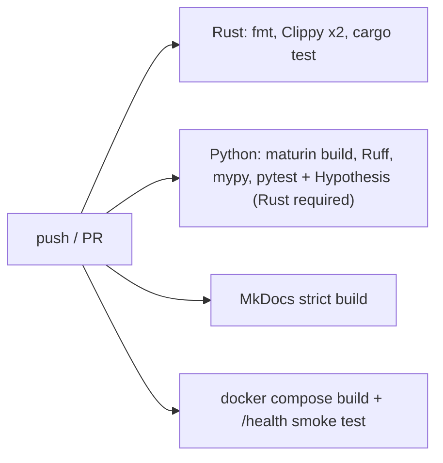

# Development

## Run locally without Docker

```bash
python -m venv .venv
.venv/bin/pip install -e ".[qiskit,plot,dev]"      # Windows: .venv\Scripts\pip
.venv/bin/pip install ./scheduler                   # optional: needs a Rust toolchain
.venv/bin/chamois serve                             # http://127.0.0.1:8000
```

Without the Rust build, the API uses the Python reference scheduler and `/health` says
`"scheduler": "python"`.

## Tests

```bash
pytest                    # unit, API, CLI, Qiskit cross-check, Hypothesis; coverage gate 85 %
cd scheduler && cargo test && cargo clippy --all-targets -- -D warnings
```

| Test file | What it proves |
| --- | --- |
| `tests/test_scheduler.py` | timing rules, rejections, Rust == Python on random circuits, validator catches broken timelines |
| `tests/test_device.py` | pulse-level simulation == Qiskit statevector on random circuits |
| `tests/test_api.py` | ARNICA routes, job states, roles, calibration, direct access, console presets |
| `tests/test_jobs.py` | cancel semantics, queue limit, worker survives a crashing job |
| `tests/test_qiskit.py` | AQT's provider runs on a live CHAMOIS server; cross-check vs offline simulator |
| `tests/test_cli.py` | operator CLI end to end |
| `scheduler/src/*.rs` | Rust unit tests (`cargo test`) |

## CI



## Docker

```bash
docker compose up --build     # API on :8000, docs on :8001
```

The image builds the Rust wheel in a first stage and ships only the wheel, so the runtime image has no
compiler.
