# Timing model: from gates to pulses

## Channels

| Channel | Physical meaning | Used by |
| --- | --- | --- |
| `cool` | global 397 nm beam for Doppler and sideband cooling | start of every shot |
| `addr_q0` … `addr_q9` | addressed 729 nm beam on one ion | `R`, and one leg of every `RXX` |
| `ms_drive` | bichromatic RF tone for Mølmer–Sørensen gates, shared by all ions | `RXX` |
| `detect` | global 397 nm detection beam + camera/PMT | end of every shot |

## Rules (one shot)

1. **Cooling** first, from t = 0.
2. **Gates** start after cooling plus the settle time. Each channel keeps its own cursor (the time it is
   free again), like the `now` cursor of ARTIQ's RTIO system. An operation starts as soon as *all* channels
   it needs are free, so gates on different ions run in parallel and gates on the same ion queue up.
3. **`R(θ, φ)`** on ion *q*: duration = θ × π-time(*q*), phase = φ minus the ion's virtual-Z frame.
4. **`RZ(φ)`** is *virtual*: no pulse, zero time. It adds φ to the ion's phase frame, and every later
   pulse on that ion is shifted by it. This is how trapped-ion systems usually implement Z rotations.
5. **`RXX(θ)`** on ions *a*, *b*: duration = (θ / 0.5) × MS gate time, on `addr_qa`, `addr_qb` and
   `ms_drive` at once. Because `ms_drive` is shared, MS gates never overlap.
6. **Detection** starts when every channel is free.
7. Every timestamp and duration is rounded to the **8 ns RTIO clock** (halves round up).

```mermaid
gantt
    title Bell pair: one shot (not to scale)
    dateFormat x
    axisFormat %L
    section cool
    cooling          :0, 1000
    section addr_q0
    R(1, 0)          :1001, 1016
    MS leg           :1017, 1217
    R(0.5, 1-frame)  :1218, 1226
    section addr_q1
    MS leg           :1017, 1217
    R(0.5, 1)        :1218, 1226
    section ms_drive
    MS drive         :1017, 1217
    section detect
    detection        :1227, 2727
```

## Validation (defence in depth)

After compiling, an independent validator checks the timeline before the device runs it. ARTIQ raises
`RTIOSequenceError` when an event goes back in time on a channel; CHAMOIS rejects the equivalent problems
up front:

| Code | Rule |
| --- | --- |
| `overlap` | two pulses on one channel overlap |
| `settle_time` | the gap between two pulses on one channel is shorter than `settle_ns` |
| `off_grid` | a timestamp or duration is not a multiple of the RTIO clock |
| `empty_pulse` | zero-length pulse |
| `qubit_disabled` | a pulse addresses a disabled ion |
| `coherence_budget` | the shot ends after `max_sequence_ns` |

The compiler cannot produce the first four by construction. Hypothesis tests check exactly that on random
circuits, and also break valid timelines on purpose to check the validator notices.

## How the device turns pulses back into physics

The simulated device reads only pulses: rotation angle = duration ÷ π-time, MS angle = 0.5 × duration ÷
MS gate time, axis = pulse phase. For two-qubit gates it applies
exp(−i θπ/2 · σφa ⊗ σφb), with σφ = cos(φπ) X + sin(φπ) Y. Because RZ is
virtual, the leftover frame at the end is a Z rotation, which does not change measurement results.

A wrong duration or phase in the scheduler would therefore show up as a wrong result. Hypothesis compares
the pulse-level simulation with Qiskit's statevector on random native circuits (with a 1 ns clock the
difference is below 10⁻³ TVD).
